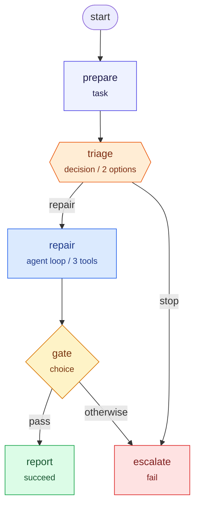

# agentflow

`agentflow` is a small, in-process workflow engine for Go programs that need a
fixed control-flow graph with LLM-driven choices. It is designed for autonomous
coding agents: the graph decides what *can* happen, and the LLM decides which
declared action to take next.

- Workflows are written as ordinary Go code with a typed state value.
- The graph is static and can be exported as a Mermaid diagram.
- `Decision` nodes expose a whitelist of routes to an LLM policy.
- `Agent` nodes run an iterative tool-selection loop with a whitelist of tools.
- Deterministic tools such as `go build`, `go test`, `go vet` and `gofmt` act as
  verification gates.
- No database, no durable execution, no replay. A run lives in memory and is
  discarded when `Run` returns.
- Standard library only. Go 1.24+.

The engine is intentionally not a general-purpose agent framework. It is a
small control-flow layer that keeps an autonomous loop inspectable and bounded.

## Contents

- [Quick start](#quick-start)
- [Why a fixed graph?](#why-a-fixed-graph)
- [Node types](#node-types)
- [API overview](#api-overview)
- [Execution semantics](#execution-semantics)
- [Visualizing a workflow](#visualizing-a-workflow)
- [Safety guardrails](#safety-guardrails)
- [The coding-agent example](#the-coding-agent-example)
- [Limitations](#limitations)
- [Project layout](#project-layout)
- [Development](#development)

## Quick start

```go
package main

import (
	"context"
	"fmt"

	"agentflow/flow"
)

type State struct {
	TestsPassed bool
}

func main() {
	wf := flow.New[State]("repair")

	wf.Task("build", func(ctx context.Context, s *State) error {
		// Run go build here.
		return nil
	}).WithRetry(flow.RetryPolicy{MaxAttempts: 2}).Next("triage")

	wf.Decision("triage", flow.DecisionSpec[State]{
		Options: []flow.RouteOption{
			{Key: "fix", Description: "apply the proposed fix", Target: "tests"},
			{Key: "stop", Description: "abort the run", Target: "give-up"},
		},
		Choose: flow.DecisionFunc[State](func(
			ctx context.Context,
			s *State,
			options []flow.RouteOption,
		) (string, error) {
			// Ask your LLM here. It may only return a key from options.
			return "fix", nil
		}),
	})

	wf.Task("tests", func(ctx context.Context, s *State) error {
		// Replace with `go test ./...`; the result drives the gate.
		s.TestsPassed = true
		return nil
	}).Next("gate")

	wf.Choice("gate", func(ctx context.Context, s *State) (string, error) {
		if s.TestsPassed {
			return "pass", nil
		}
		return "", nil // the Otherwise route
	}).When("pass", "done").Otherwise("give-up")

	wf.Succeed("done")
	wf.Fail("give-up", "tests still fail")

	var state State
	result, err := wf.Run(context.Background(), &state)
	fmt.Println(result.Status, err)
	fmt.Println(wf.Mermaid())
}
```

A run returns a `*flow.Result[T]` containing the final status, the shared state,
the node visit count and the full execution trace. If a node fails and no error
route handles it, `err` is non-nil and the result status is `failed`.

## Why a fixed graph?

Letting an LLM invent the control flow makes runs hard to bound, test and
explain. `agentflow` splits responsibilities:

1. **Go code owns the graph.** Nodes, routes, retries, gates and limits are
   declared by the programmer.
2. **The LLM owns a choice.** A `Decision` policy picks one declared route. An
   `Agent` policy picks one declared tool or declares the loop finished.
3. **Deterministic tools own verification.** A coding agent can propose a patch,
   but `go test` decides whether the patch is acceptable.

This keeps the graph suitable for Mermaid export and makes every LLM action
validatable before it is executed.

## Node types

| Builder | Behaviour | Continuation |
| --- | --- | --- |
| `Task` | Runs a function once, optionally with retries. | `Next` |
| `Choice` | Runs a deterministic function that returns a route key. | `When` / `Otherwise` |
| `Decision` | Asks a `DecisionPolicy` to choose a declared option. | `RouteOption.Target` |
| `Parallel` | Runs branches concurrently and waits for all of them. Branches share state. | `Next` after the join |
| `ParallelIsolated` | Runs branches concurrently on isolated state copies, then merges. Mutex-free. | `Next` after the join |
| `Wait` | Sleeps for a fixed duration, interruptible by context cancellation. | `Next` |
| `Agent` | Runs a policy/tool loop until `Done`, `Fail`, or the iteration limit. | `Next` |
| `SubWorkflow` | Runs a nested workflow as a single node, sharing state. Can nest to any depth. | `Next` after the sub-workflow completes |
| `Succeed` | Ends the workflow successfully. | terminal |
| `Fail` | Ends the workflow with an error message. | terminal |

Every node can declare an error route with `Catch(target, match)`. Routes are
checked in declaration order; a `nil` matcher catches any error.

## API overview

### Building a workflow

```go
wf := flow.New[State]("name")     // the first node becomes the start
wf.StartAt("some-node")           // optional override
wf.Task(name, fn)                 // TaskFunc
wf.Choice(name, fn)               // ChoiceFunc
wf.Decision(name, spec)           // DecisionSpec
wf.Parallel(name, branches...)    // Branch
wf.ParallelIsolated(name, copy, merge, branches...) // Branch with per-branch state copies
wf.SubWorkflow(name, sub)                           // Nested workflow as a single node
wf.Wait(name, duration)
wf.Agent(name, spec)              // AgentSpec
wf.Succeed(name)
wf.Fail(name, message)

node.Next("target")
node.When("key", "target")
node.Otherwise("target")
node.WithRetry(flow.RetryPolicy{...})
node.Catch("target", func(err error) bool { ... })
```

Node names use `flow.NodeName`, a defined string type. String literals convert implicitly:

```go
wf.Task("build", fn).Next("triage")   // "build" and "triage" become NodeName
```

When a name comes from a `string` variable, convert it explicitly:

```go
var n string = "build"
wf.Task(flow.NodeName(n), fn)
```

Builder mistakes such as duplicate node names, duplicate route keys, empty route
keys and missing route targets panic immediately. Cross-node problems such as a
destination that does not exist are reported by `Validate`, which `Run` calls
before executing anything.

### Decision nodes

A `Decision` is the preferred way to let an LLM choose a path. The policy only
sees the declared options and the typed state:

```go
wf.Decision("pick-strategy", flow.DecisionSpec[State]{
	Options: []flow.RouteOption{
		{Key: "patch", Description: "change the existing code", Target: "repair"},
		{Key: "rewrite", Description: "replace the file", Target: "rewrite"},
		{Key: "stop", Description: "give up", Target: "fail"},
	},
	Choose: myLLMPolicy{},
	MaxAttempts: 2, // invalid responses get another chance
})
```

If the policy returns a key that is not declared, the engine records a
`decision_rejected` event and asks again up to `MaxAttempts` times. If it still
cannot produce a valid option, the node fails.

### Agent nodes

An `Agent` is an iterative tool loop for work where the number of steps is not
known in advance. The policy is shown the full transcript of previous turns:

```go
wf.Agent("repair", flow.AgentSpec[State]{
	Goal: "Make the tests pass.",
	Policy: flow.AgentFunc[State](func(
		ctx context.Context,
		s *State,
		history []flow.AgentTurn,
	) (flow.AgentDecision, error) {
		if s.TestsPassed {
			return flow.AgentDecision{Done: true}, nil
		}
		return flow.AgentDecision{
			Thought: "Try the existing proposed fix.",
			Tool:    "apply_patch",
			Args:    map[string]string{"path": "math.go"},
		}, nil
	}),
	Tools: []flow.Tool[State]{
		{
			Name:        "apply_patch",
			Description: "Patch a workspace file.",
			Run: func(ctx context.Context, s *State, args map[string]string) (string, error) {
				// Apply the patch and return an observation for the policy.
				return "patched math.go", nil
			},
		},
	},
	MaxIterations: 8,
})
```

A policy response has three modes:

- `Done: true` ends the loop successfully.
- `Fail: true` ends the agent with an error. The `Message` is used as the error.
- Otherwise `Tool` must name a declared tool. `Args` is passed to the tool.

Unknown tools and malformed responses are appended to the transcript as errors
instead of crashing the run, so a real LLM can correct itself. Tool errors are
also observations; the policy decides whether to retry or fail. Every tool call
is bounded by `MaxIterations`.

### Retries and error routes

```go
wf.Task("format", gofmt).WithRetry(flow.RetryPolicy{
	MaxAttempts:     3,
	InitialInterval: 100 * time.Millisecond,
	Backoff:         2,
	MaxInterval:     time.Second,
})

wf.Task("build", goBuild).
	Catch("recover", func(err error) bool { return isBuildError(err) }).
	Next("test")
```

Retries apply to `Task` nodes only. `Catch` applies to any non-terminal node. If
an error matches, the engine follows the error route and continues; otherwise
the workflow fails. Context cancellation always wins: cancellation is reported
as `StatusCanceled`, not routed through `Catch`.

A `SubWorkflow` node that fails returns a `*flow.SubWorkflowError`, which wraps
the sub-workflow's terminal error and attaches its execution trace. Use
`flow.MatchIs` or `flow.MatchAs` on `Catch` to match it:

```go
wf.SubWorkflow("process", sub).
    Catch("recover", flow.MatchAs(&flow.SubWorkflowError{})).
    Next("report")
```

The attached trace lets you drill into what happened inside the sub-workflow
without running it in isolation.

### Graph validation

`Validate()` (called automatically by `Run`) performs whole-graph checks in
addition to per-node validation:

- **Unreachable nodes:** Any node that cannot be reached from the start node
  is reported as an error. This catches dead code and typos in route targets.
- **Dead loops:** Any reachable node that cannot reach a terminal node
  (`Succeed` or `Fail`) is reported as a potential infinite loop. This catches
  cycles that would otherwise burn the `MaxSteps` budget at runtime.
- **Missing terminal:** A workflow with no `Succeed` or `Fail` node is
  rejected.

These checks run before any node executes, so graph mistakes surface
immediately rather than mid-run.

### StatusBusinessFailed

A `Fail` node now ends the workflow with `StatusBusinessFailed` (rather than
`StatusFailed`). The error is still returned (the `FailMessage`), but callers
can distinguish a deliberate business outcome from an unhandled system error
by checking `res.Status`:

```go
if res.Status == flow.StatusBusinessFailed {
    // The workflow ended at a Fail node — expected, not a bug.
} else if res.Status == flow.StatusFailed {
    // A node failed with no error route handling it — unexpected.
}
```

Both statuses return a non-nil error, so existing `err != nil` checks
continue to work.

### Observing a run

```go
result, err := wf.Run(ctx, &state,
	flow.WithMaxSteps(200),
	flow.WithObserver(func(event flow.Event) {
		log.Printf("%s %s", event.Kind, event.Node)
	}),
)
```

Events cover node transitions, retries, route selection, rejected decisions,
agent thoughts, tool calls and workflow completion. They are stored on
`result.Trace` and delivered to the observer in order. The observer is called
from the goroutine driving the run, not from parallel branches.

## Execution semantics

- A run starts at the first declared node unless `StartAt` overrides it.
- Each node visit counts as one step. The default limit is
  `flow.DefaultMaxSteps` (1000); loops are allowed but bounded.
- `Decision` attempts and agent iterations have their own limits and do not
  consume the graph step budget.
- `Choice` returns a route key. An empty key selects the `Otherwise` route when
  one was declared. Unknown keys fail the node.
- `Parallel` starts all branches, waits for all of them, then continues at the
  join. The first error in declaration order is returned. Branches share the
  state value, so callers must synchronise concurrent writes. A failing branch
  cancels in-flight siblings via context.
- `ParallelIsolated` gives each branch its own deep copy of state, so branches
  cannot race on shared fields. A `copy` function creates each branch's copy
  and a `merge` function folds all copies back into the main state after the
  join. No mutex is needed for disjoint writes.
- `SubWorkflow` runs a nested workflow as a single node. It shares the parent's
  state and counts as one opaque step against the parent's `MaxSteps` budget.
  The sub-workflow has its own internal step budget. On failure, a
  `flow.SubWorkflowError` is returned with the sub-workflow's trace attached,
  so the parent can debug what happened inside using `flow.MatchAs` or
  `flow.MatchIs` on `Catch` routes. Sub-workflows can be nested to any depth.
- `Wait` is a context-aware timer. Cancellation produces `StatusCanceled`.
- `Succeed` and `Fail` are terminal and cannot have outgoing edges.

## Visualizing a workflow

`Workflow.Mermaid()` returns a deterministic Mermaid flowchart. Node declaration
order is preserved, so repeated calls produce identical output. The coding-agent
example produces [`docs/coding-agent.mmd`](docs/coding-agent.mmd):



Error routes are drawn as dotted edges labelled `error`. Parallel branches are
rendered in a subgraph with fan-out and join edges. The diagram describes the
static graph; it does not show the runtime state of a particular run. Use the
execution trace for that.

## Safety guardrails

- **The LLM never authors the graph.** It only returns route keys or tool calls.
- **Decision options are whitelisted.** Invalid options are rejected and retried,
  then fail the node.
- **Tools are whitelisted.** Unknown tool names are fed back as observations
  rather than executed.
- **Loops are bounded.** `MaxSteps` protects graph cycles; `MaxIterations`
  protects agent loops.
- **Cancellation is respected.** Pass a context and use `exec.CommandContext` for
  subprocesses so a canceled run stops.
- **Parallel branches can run lock-free.** Use `ParallelIsolated` to give each
  branch its own state copy; merge results back after the join. No mutex needed
  for writes to disjoint fields.
- **Verification is deterministic.** For coding tasks, use `go build`, `go test`,
  `go vet` and `gofmt` as gates. Do not let the LLM decide whether tests pass.
- **The engine never spawns a shell.** Tools decide what they execute; keep
  workspace paths confined to a root as the example does.

Treat an LLM policy as untrusted input: validate its output, bound its actions,
and verify results with code.

## The coding-agent example

[`examples/codingagent`](examples/codingagent) builds a temporary Go module with
a buggy `Add` function and a failing test. A `Decision` node chooses whether to
repair or abort. An `Agent` node then uses three tools:

- `read_file` to inspect `math.go`,
- `apply_patch` to replace `return a - b` with `return a + b`,
- `run_tests` to run the real `go test ./...`.

A `Choice` gate checks the recorded test result, then the workflow succeeds or
fails. The mock LLM is deterministic so the example runs offline, but the
policy interfaces are the same ones a real LLM client would implement.

Run it:

```sh
go run ./examples/codingagent
go run ./examples/codingagent -trace=false
go run ./examples/codingagent -keep        # keep the temporary workspace
go run ./examples/codingagent -mermaid     # print the diagram
```

## Limitations

- **In-process only.** There is no persistence, checkpointing, resume, durable
  execution or replay. If the process dies, the run is lost.
- **No expression language.** Branch conditions and state access are Go code.
  There is no JSONPath or ASL-style data path layer.
- **No built-in LLM client.** Implement `DecisionPolicy` and `AgentPolicy` for
  your provider. The library does not manage prompts, models or token budgets.
- **No automatic state merging.** `Parallel` branches receive the same state
  pointer; use atomics, mutexes, or `ParallelIsolated` (per-branch copies with a
  merge step) if branches write concurrently.
- **No distributed execution.** Parallel means goroutines in one process.
- **No human-in-the-loop node.** Model approval as a policy or an external
  signal inside a `Task`.
- **Traces are in memory.** Export `Result.Trace` yourself if you need durable
  audit logs.
- **Mermaid is structural.** Runtime progress, retries and token usage are not
  overlaid on the diagram.
- **Fearless concurrency is not free.** A policy or tool may block; respect the
  context and keep tool calls bounded.

## Project layout

```text
agentflow/
  flow/
    flow.go       types, builders and validation
    run.go        execution engine, events and agent loop
    mermaid.go    deterministic Mermaid rendering
    flow_test.go  engine and rendering tests
  examples/
    codingagent/
      main.go     runnable coding-agent workflow
      main_test.go
  docs/
    coding-agent.mmd
```

## Development

```sh
gofmt -w .
go vet ./...
go test -race ./...
go run ./examples/codingagent
```

Or use the Makefile:

```sh
make fmt
make vet
make test
make example
make mermaid   # regenerate docs/coding-agent.mmd
```
